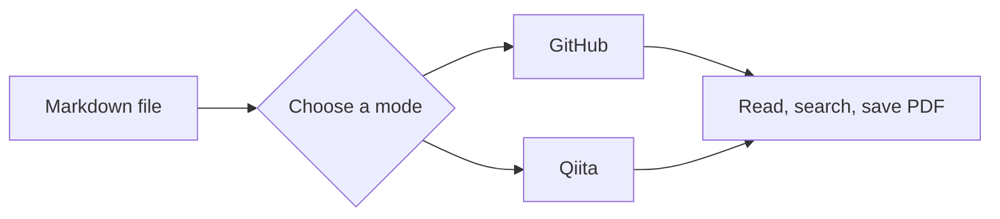

# Markdown display sample

**MDV** is a Windows Markdown viewer with GitHub and Qiita syntax modes.

Switch **GitHub / Qiita** at the top right to see this sample change. Syntax interpretation and appearance also vary by engine. Drop a file or press <kbd>Ctrl</kbd> + <kbd>O</kbd> to open your own document.


## Common syntax

Tables, lists, **bold**, *italic*, ~~strikethrough~~, `inline code`, and emoji :sparkles: are supported.

| Feature | Shortcut |
| :--- | :--- |
| Open file | Ctrl + O |
| Find in document | Ctrl + F |
| GitHub / Qiita | Ctrl + 1 / Ctrl + 2 |
| Show source | Ctrl + U |
| Reload / Print | F5 / Ctrl + P |

- [x] Open and read a file
- [x] Jump to a heading from the outline
- [ ] Try your own Markdown

### Line breaks

An ordinary line break separates this line from the next.
Qiita displays the break; GitHub joins the lines into one paragraph.

## GitHub alerts

> [!NOTE]
> GitHub mode displays this quote as an alert box.

> [!TIP]
> Saving a file in an external editor automatically updates the preview.

## Qiita notes

:::note info
Qiita mode displays a note box. **Bold text** and lists are also supported.
:::

:::note warn
Identical display to either service is not guaranteed. See Help → Compatibility for an overview.
:::

### Filenames and diffs

Qiita mode displays filenames above code blocks.

```javascript:hello.js
const message = 'Hello, Markdown!';
console.log(message);
```

```diff_python:example.py
-print("before")
+print("after")
```

## Math

Inline math $`E = mc^2`$ and block math are supported.

```math
\sum_{k=1}^{n} k = \frac{n(n+1)}{2}
```

## Mermaid diagrams

Mermaid creates diagrams from text. PDF (Portable Document Format) preserves document layout.



## Collapsible sections and footnotes

<details><summary>Click to show details</summary>

You can use **Markdown** here. Leave a blank line after HTML tags.

1. Open a file
2. Choose a mode
3. Read

</details>

Footnote references are supported.[^note]

[^note]: Documents are processed in this app, without sending their text to external conversion services.

## Links

[Open another local document](another.en.md#linked-heading) / [Back to common syntax](#common-syntax)

Qiita mode displays standalone URLs in a link card frame.

https://qiita.com/Qiita/items/c686397e4a0f4f11683d
